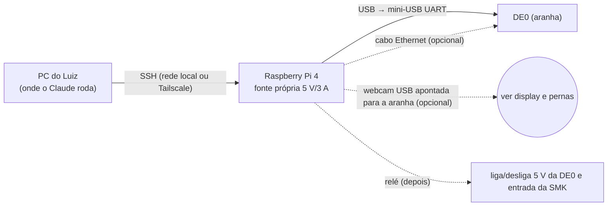

# Bancada remota com Raspberry Pi 4

> **2026-10-30:** com a [[00-Inbox/proposta-ADR-011-pi-ros-visao-na-fpga]] o Pi 4 passa a ir **em cima** da aranha, ligado à DE0 por Ethernet. Se for aceita, este rascunho vira parte da S10: o mesmo Pi dá ssh/Wi-Fi para a bancada remota.

O Pi fica **ao lado** da aranha como instrumento de bancada, e não dentro do robô. Por isso não contradiz a decisão de "sem Raspberry Pi" na arquitetura (o robô continua só com DE0 + FPGA). Quando for implementar, vira spec (S10) e precisa de aprovação antes de qualquer compra.

## Montagem

| Peça | O que destrava |
|---|---|
| **Pi + cabo UART** (mínimo) | Rodar testes, gravar firmware e ler logs sem ninguém no cabo (`tools/uart.py` roda igual no Pi) |
| **Ethernet Pi↔DE0** | Gravar firmware em segundos, contra ~3 min pela UART; trocar o `.rbf` montando a p1 do microSD na própria placa, sem tirar o cartão. [INFERÊNCIA: o kernel 3.13 deve ter o driver da Ethernet (stmmac); a imagem não tem rede configurada nem ssh. Testar `ifconfig eth0` e o que o BusyBox oferece (`nc`, `tftp`, `wget`).] |
| **Webcam USB no Pi** | Ver o display e o movimento das pernas: o Claude lê as imagens e verifica o resultado sem depender de relato |
| **Relé de 2 canais** | Desligar/religar a DE0 quando ela trava (hoje isso exige o Luiz); E-stop remoto dos servos (corta a entrada da SMK) |

## Regras de segurança (entram na spec)
- Servos sem ninguém por perto: **só com a aranha suspensa** (pernas no ar, sobre um suporte) **e com fonte DC no jack da SMK (6,2–12 V)**. Nunca pela bateria: em 2026-10-29 a bateria fraca disparou o corte do CPLD, e descarregada sem supervisão ela estraga (manual do Spider).
- A aranha no chão anda só com humano presente e a chave da SMK ao alcance.
- O Pi tem fonte própria e não é alimentado pela aranha.
- O watchdog continua opt-in (ver `watchdog-dw-wdt-reinicia.md`). Com o relé, o power-cycle remoto cobre o caso "placa muda".

## Limites
- O Claude só trabalha enquanto há uma sessão aberta. O ganho é que o Luiz não precisa estar do lado da aranha, não que o trabalho siga sozinho.
- Fiação, bateria e troca de peças continuam com o Luiz.
- Com o PC na mesma mesa da aranha, ele já faz o papel do Pi. O Pi vale quando a aranha fica em outro lugar ou ligada direto.

## Para começar (checklist do Luiz)
1. Pi 4 com **Raspberry Pi OS Lite**, SSH habilitado, fonte própria.
2. `ssh-copy-id usuario@<ip-do-pi>` a partir do PC; anotar o IP (ou instalar Tailscale para acesso fora de casa).
3. Cabo USB do Pi no mini-USB **UART** da DE0 (lado do Ethernet, não o do Blaster).
4. Avisar o Claude. Ele instala `python3-serial`, coloca o usuário no grupo `dialout`, testa a UART e depois a Ethernet.

## Depois (opcional, nesta ordem)
1. Cabo Ethernet Pi↔DE0: IP fixo nos dois e transferência de arquivos.
2. Webcam USB (qualquer UVC; o Pi tem driver) e captura por `fswebcam`/`ffmpeg`.
3. Módulo relé 2 canais (bobina 5 V, entrada compatível com 3,3 V), um canal na saída da fonte 5 V da DE0 e outro na entrada DC da SMK. Spec própria antes de ligar qualquer coisa.
