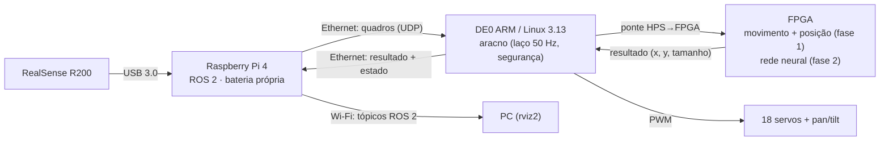

# ADR-011 — Raspberry Pi 4 + RealSense R200 + ROS na aranha; FPGA faz o reconhecimento

## Contexto
- **Professor (2026-10-30, via Luiz):** um Pi em cima da FPGA. A FPGA cuida do movimento, o Pi cuida da imagem e do ROS, e o reconhecimento de imagem fica na FPGA.
- **A R200 não liga na DE0.** O datasheet da R200 (§6.1, Intel 334616-001) diz: *"The module does not support USB2.0 connections and does not route the USB2.0 pins"*. A DE0 só tem USB 2.0 OTG (USB3300; [[40-Fontes/de0-nano-soc-user-manual]] §3.7.6). Teste de 2026-10-30: com a R200 no OTG, nenhum evento de enumeração no `dmesg`.
- **A DE0 não tem pilha de vídeo.** O kernel 3.13 traz `# CONFIG_MEDIA_SUPPORT is not set`, e não há módulos para essa versão.
- **USB de vídeo na DE0 é instável.** A PS3 Eye (`1415:2000`) enumerou e caiu ("port 1 disabled by hub (EMI?)"), depois deu `error -71` e "Cannot enable port 1". Depois disso a porta não detectou mais nada, nem após reboot.
- **A rede da DE0 já funciona.** A placa tem Ethernet ligada ao HPS (manual Fig. 2-1), e o boot mostra `eth0` e `sshd`.
- **Visão é necessária.** A S05 mostrou que, sem visão, a política não distingue pessoa de parede (teto de ~14 %, [[00-Inbox/politica-nao-distingue-pessoa-de-parede]]).
- **Energia:** em 2026-10-29 o corte do CPLD da SMK desligou servos e DE0 juntos ([[50-Diario/2026-10-29-camera-s09]]). Uma placa extra na mesma bateria cairia junto.

## Decisão
Um **Raspberry Pi 4** com bateria própria vai em cima da aranha, com a **RealSense R200** em USB 3.0, e roda **ROS 2**. O Pi manda quadros por **cabo Ethernet** à DE0. O ARM recebe e passa à **FPGA**, que faz o reconhecimento: fase 1 é detecção de movimento + posição; fase 2, uma rede neural pequena. O resultado fica na DE0, que decide o comportamento e move os servos, e uma cópia volta ao Pi, que publica no ROS para o PC.

## Divisão de papéis
| Peça | Faz | Não faz |
|---|---|---|
| **Pi 4** | Captura da R200, compressão/redução do quadro, nó ROS 2 de ponte (publica imagem, profundidade, resultado e estado), Wi-Fi, ssh, bancada remota ([[00-Inbox/bancada-remota-raspberry-pi]]) | Decidir comportamento ou mover servos |
| **DE0 ARM** | Recebe quadros, alimenta a FPGA, lê o resultado, política/FSM, camada de segurança, laço de 50 Hz, display | ROS (Linux 3.13 sem compilador; no máximo micro-ROS mais tarde) |
| **FPGA** | PWM (como hoje), display SPI, reconhecimento com latência fixa | — |

## Pontos técnicos (a detalhar nas specs)
- **Banda:** 320×240 a 8 bits = 77 kB por quadro; a 15 quadros/s ≈ 9 Mbit/s, muito abaixo do enlace. O gargalo provável é a cópia ARM→FPGA pela ponte LW: 19.200 escritas por quadro a 0,3–0,6 µs cada ≈ 6–12 ms [INFERÊNCIA]. Se não bastar, usar a ponte HPS→FPGA de 128 bits.
- **Protocolo Pi↔DE0:** UDP próprio (quadro em pedaços com número de sequência; resultado e estado de volta). A DE0 não vira nó ROS; quem traduz para ROS é o nó de ponte no Pi.
- **Sem Pi, a aranha continua segura.** Se os quadros pararem, a DE0 volta à FSM/política com os sensores próprios. A camada de segurança fica onde está.
- **R200 no Pi:** o SDK atual (librealsense2) e o `realsense-ros` não suportam a R200. O pacote ROS antigo (`realsense_camera`) é do ROS 1 Kinetic. Plano:
  1. No PC, verificar se o `uvcvideo` do kernel atual já expõe a profundidade (Z16) da R200. O PC criou `/dev/video2..7` sem patch.
  2. Se expuser, escrever um nó ROS 2 próprio via V4L2, sem SDK.
  3. Se não, compilar a librealsense v1.12.1 (backend libusb) no Pi.
  4. Plano C: câmera UVC comum, mesmo formato de quadro para a FPGA.
- **ROS 2:** Jazzy no Ubuntu 24.04 para o Pi 4 (aarch64, plataforma Tier 1). O PC é Fedora, então ROS 2 roda em container Ubuntu 24.04 (Docker já usado pelo projeto).
- **Energia:** power bank USB-C ≥ 3 A só para o Pi + R200 (Pi 4 até ~3 A; R200 1,0–1,6 W, datasheet Tabela 6-3). Independente da bateria da SMK: o corte do CPLD não derruba o Pi.

## Acréscimo 2026-11-06 — LiDAR SLAMTEC Mapper (do professor)
- **Identificado na bancada:** ligado por Ethernet ao PC, responde como `SlamWare-6FFB95.local` em `192.168.11.1`. Ele mesmo é servidor DHCP (deu `192.168.11.200` ao PC), tem web "Slamtec Device Management" (porta 80), ssh (22) e a porta do SDK (1445). Modelo exato (M1M1/M2M2/M2M3) a confirmar na interface web.
- **O que é:** não é um LiDAR simples. É um *LiDAR com SLAM embutido*. Pelo datasheet M2M2 v1.1, entrega varredura 360° (9200 pontos/s, até 40 m), mapa (resolução 0,05 m) e **pose (x, y, θ) a 10 Hz** calculados nele mesmo. Tem IMU de 9 eixos e foi feito para mapear na mão, sem odometria. Isso resolve o "se geolocalizar" (ADR-003) sem SLAM no Pi.
- **Integração proposta:** Mapper ligado ao Pi. O Pi tem uma única Ethernet, que vai para a DE0, então o Mapper entra por Wi-Fi, por adaptador USB-Ethernet no Pi ou por um switch pequeno. O nó ROS da Slamtec (`slamware_ros_sdk`) publica scan, mapa e pose; para Mapper em ROS 2 o suporte ainda está [A VERIFICAR]. A DE0 recebe só um resumo (pose + distância à frente/ao chão) pelo mesmo enlace UDP da S10.
- **Riscos:**
  - O datasheet limita a inclinação a **±3°** durante o mapeamento, e a aranha balança ao andar: medir a qualidade do mapa andando.
  - A janela óptica precisa de visão livre em 360°, e a cabeça/R200 não pode tapar.
  - Alimentação 5 V (4,95–5,3 V, pico de partida 1,5 A, típico 750 mA): power bank do Pi, nunca a bateria da SMK.
  - Peso a medir.
  - Parafusos M2.5 da base ≤ 6 mm (datasheet).
- **Efeito no plano:** pode substituir o HC-SR04 frontal (o de borda de mesa continua) e dá "casa" fixa no mapa em vez de "lugar mais escuro". Entra como spec própria depois da S10 (enlace) e da S12 (R200).

## Alternativas descartadas
- **R200 direto na DE0:** a câmera é só USB 3.0 e a DE0 só tem USB 2.0 (testado).
- **OV7670 na FPGA (ADR-010):** a FPGA e o firmware ficaram prontos (S09), mas a câmera não se comunicou na bancada (sem 3,3 V, provável), e o professor pediu Pi + ROS.
- **Webcam USB 2.0 na DE0:** o kernel não tem V4L2 e a porta OTG caiu com a PS3 Eye.
- **Reconhecimento no Pi:** seria mais simples, mas o professor quer o reconhecimento na FPGA. O Pi fica com captura e ROS.
- **Pi 5:** pede fonte de 5 A e esquenta mais; o Pi não processa a imagem, então o Pi 4 basta.

## Consequências
- **Código que continua:** servos, segurança, display, ponte ARM↔FPGA e o fluxo Quartus (S03, S04, S08).
- **S09 (OV7670) suspensa:**
  - O `cam_capture` (RAM de quadro + registradores) vira base da entrada do acelerador. Muda a origem dos dados: escrita pelo ARM, não pela câmera.
  - `hal/sccb` e `cam/ov7670` ficam no repo e no build; S09 passa a `status: suspensa`.
- **Specs novas:**
  - S10, enlace Pi↔DE0 (Ethernet, UDP, nó ROS 2 de ponte);
  - S11 — medula na FPGA: olhar que segue, reflexo de susto, watchdog de servos (entrada: profundidade da R200);
  - S12, R200 no Pi;
  - mais tarde, rede neural.
- **Peso nas costas** (Pi 4 + R200 + power bank): medir. Os MG996R já carregam a cabeça pan/tilt.
- **Reabre esta decisão:** se a R200 não entregar profundidade no Pi (cai para câmera UVC, mantém o resto); se o peso ou a energia não couberem; se o professor quiser o reconhecimento no Pi.

## Pendências após o aceite
- [x] Teste da R200: formatos e profundidade medidos no Pi, ver [[30-Medicoes/2026-11-06-raspberry-pi-4]].
- [ ] Confirmar com o professor: ROS 2 só no Pi.
